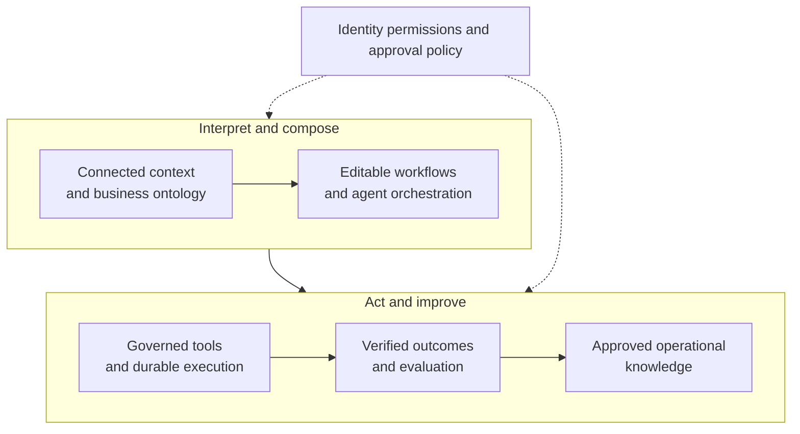
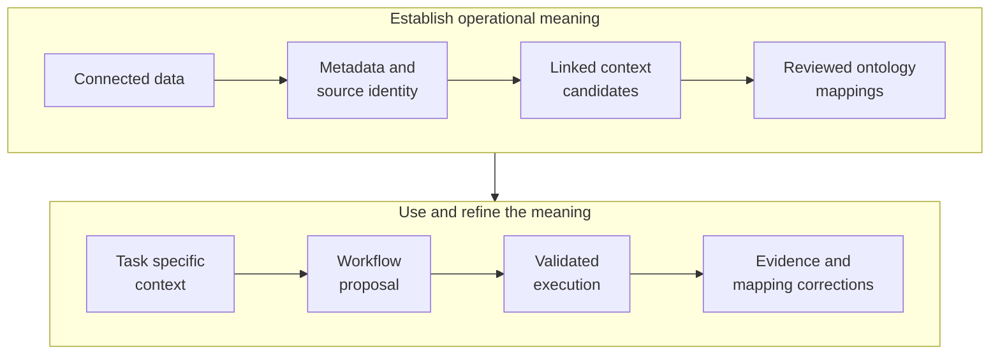
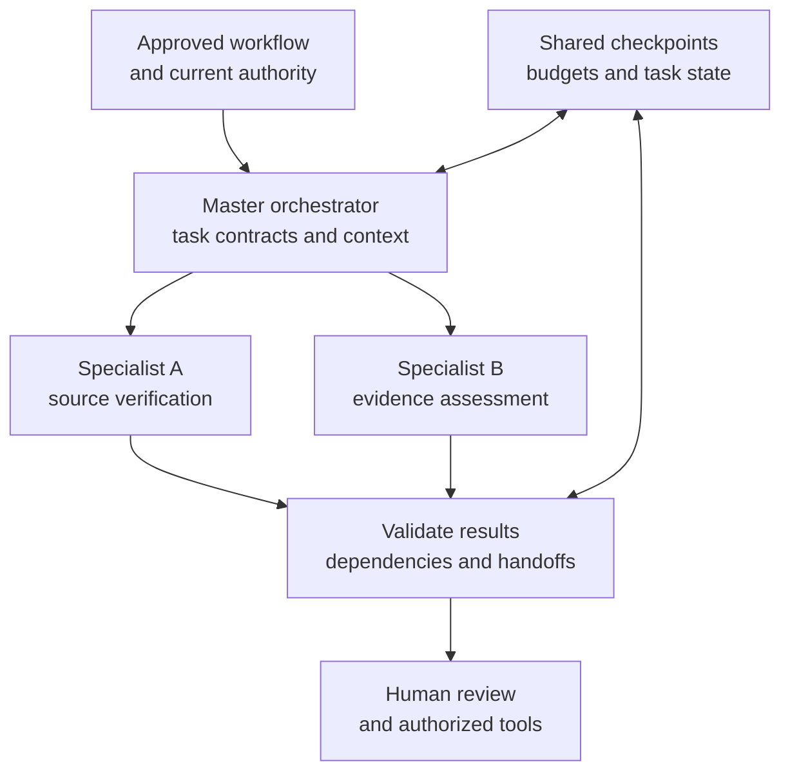
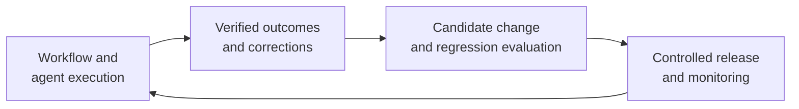
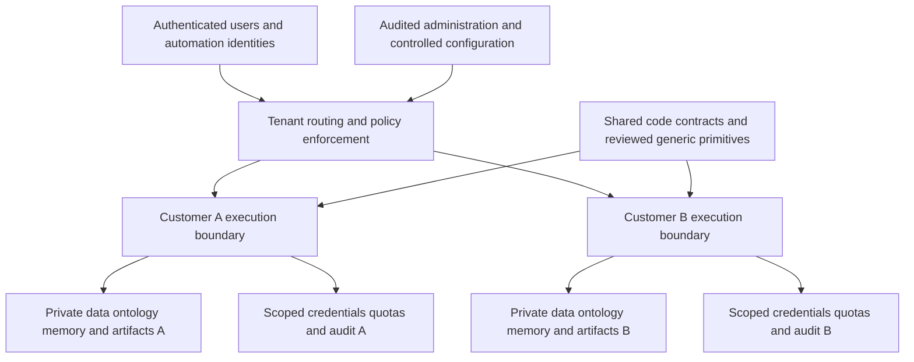

# Context-to-Execution Intelligence

**Technical architecture and long-term defensibility** 
**22 October 2026**

## A. Technical vision and architectural foundation

### From fragmented information to verified action

Organizations operate through systems that describe the same work in different ways. A request may reference an entity in one application, depend on a rule maintained elsewhere, and require actions across several services. Converting that request into a reliable process requires more than interpreting language: the platform must resolve meaning, establish current facts, identify permitted actions, manage dependencies and verify what actually happened.

The platform’s technical vision is a **context-to-execution intelligence layer**. It connects operational systems, builds a consistent interpretation of their data, translates intent and events into visible workflows, coordinates specialized agents and executes actions through governed boundaries. Outcomes then become evidence for improving subsequent workflows.

The architecture joins interpretation to action and action to evidence. The ontology defines meaning; the context layer selects relevant current information; the workflow makes the proposed process inspectable; orchestration controls progress; governance controls effects; evaluation determines what deserves reuse.

**The defensibility thesis is integration depth.** The opportunity is to accumulate validated semantic mappings, executable workflow structures, recovery patterns and evaluations that make this entire cycle more dependable. No individual component establishes uniqueness. The advantage depends on how effectively their shared evidence improves creation speed, execution reliability and cost per successful outcome.

<!-- pagebreak -->

### One operating model across the platform

The central architectural asset is a consistent set of identities and contracts connecting business entities, data sources, workflow versions, agent tasks, permitted actions and observed outcomes. Those links allow the platform to explain both why it proposed a process and whether that process produced the intended result.

| Layer | Responsibility | Connection to the next layer |
|---|---|---|
| Business ontology | Define entities, relationships, events, rules and action semantics | Gives intent and source data a shared interpretation |
| Context layer | Assemble authorized, relevant and current task evidence | Grounds workflow generation and agent decisions |
| Orchestration | Translate a workflow into bounded, dependency-aware tasks | Coordinates models, deterministic steps and human decisions |
| Agent execution | Interpret assigned evidence and propose typed results or actions | Supplies outputs for validation and controlled dispatch |
| Governance | Enforce identity, policy, approvals and action boundaries | Makes consequential execution reviewable and attributable |
| Memory and evaluation | Retain verified experience and assess changes | Improves future context, workflow proposals and routing |

The product already has foundations in visual workflow creation, source metadata discovery, reviewed relationship semantics, structured planning, bounded delegation, durable execution and approval controls. The architecture develops those foundations into a unified ontology and context service, an embedded canvas conversation, verified operational memory, comprehensive economics and enterprise tenant controls. These extensions form the next product layers; advanced learned optimization follows evidence from evaluated operation.

A crucial separation runs through every layer: **a proposal is different from permission, and an attempted action is different from a confirmed outcome**. Agents can recommend a transition, but application logic determines whether it is legal. A workflow can complete its technical steps while its ultimate business outcome remains pending. These distinctions make feedback useful rather than misleading.

The intended customer value is continuity: users can move from a request to a visible process, from that process to governed action, and from execution back to a defensible explanation without reconstructing the evidence across disconnected interfaces.

As validated knowledge accumulates, the platform can reuse more than prompts. It can reuse the meaning of fields, the prerequisites of actions, the shape of reliable workflows and the tests that establish acceptable behavior. That shared operating model is the foundation for the moat developed in the following sections.

<!-- pagebreak -->

## B. Unified business context and semantic ontology

### Current operational data, linked into task context

Connectors establish the platform’s reach into business applications, APIs and live databases. Each connection carries an owner, authorized resources, credential reference, available operations and a refresh policy. Discovery captures schemas, field types, keys, events and descriptive metadata. Reads and changes then use scoped tool operations rather than exposing unrestricted source access to agents.

The **context-linking layer** turns these source descriptions into task-relevant evidence. It resolves entity identifiers across systems, relates fields to reviewed concepts, checks source versions and attaches provenance. The same entity name can refer to different records; the same record can have several source-specific identifiers. Linking therefore begins with stable source keys and explicit mappings. Ambiguous matches remain candidates until sufficient evidence or review establishes the relationship.

For each task, context construction follows four operations:

1. **Establish authority:** determine the tenant, acting principal, purpose, allowed resources and agent role.
2. **Resolve meaning:** select the relevant ontology concepts, entity identities, source mappings and applicable rules.
3. **Acquire evidence:** retrieve only the required metadata, current fields, workflow state, tool results and eligible memories.
4. **Package the decision:** preserve source references, observation times, unresolved conflicts and a bounded token budget.

A context package is a controlled view for one decision, not a copy of the organization’s data. A specialist checking a prerequisite receives the required source attributes and rule; a specialist preparing a communication receives the approved result and recipient conditions. Large artifacts remain behind access-controlled references.

Freshness is explicit. A recently rebuilt index can still describe old source data. The platform distinguishes when a source fact was valid, when it was observed and which version supported the decision. Critical attributes are checked again before an external change. Conflicting observations remain visible until their identity, timing or source-authority differences are resolved.

**Customer value:** fewer hidden data assumptions and clearer decisions about when a workflow can proceed, needs clarification or must wait for updated evidence.

**Accumulating advantage:** accepted entity links, source-specific normalization rules and reviewed mapping corrections can reduce repeated integration work within each customer. Their quality becomes measurable through mapping accuracy, required-context coverage and fewer source-selection corrections. Reusable mapping methods can improve across deployments while customer records and private mappings remain isolated.

<!-- pagebreak -->

### The ontology as an inspectable operating vocabulary

The ontology defines business meaning and its connection to action: entities, relationships, events, rules and operations become inspectable concepts. Relationship navigation supports that foundation; the ontology establishes how those relationships should be interpreted.

| Element | Operational definition |
|---|---|
| Entity and property | Stable concepts, identifiers, typed attributes and source bindings |
| Relationship | Meaning, direction and approved source mappings |
| Event, rule and constraint | Meaningful changes, validation conditions and review requirements |
| Action | Typed inputs, preconditions, intended effects and policy references |
| Provenance and version | Supporting source, reviewer and semantic release |

Action definitions describe possible operations. Current identity, policy and approval determine whether a particular run may execute them.

Metadata establishes initial context candidates; review produces mappings that ground later task context and workflows. Execution evidence feeds proposed corrections into the next reviewed release.

A shared foundation defines generic entities, principals, tasks, resources and events. Customer modules add local meanings and rules; task profiles select the relevant subset. Stable identifiers and pinned versions keep agents consistent without sending each one the entire ontology.

Declared constraints, reviewed meanings, observed facts and inferred associations stay distinct. Similar names may suggest a mapping; they cannot establish a join or grant write access. Changes identify affected workflows and knowledge before activation.

**Customer value and accumulated advantage:** one validated semantic binding can serve many workflows. As reviewed definitions and action bindings deepen, interpretation can become more consistent and change impact more predictable. Accuracy and reuse—not graph size—establish the asset’s value.

<!-- pagebreak -->

## C. Intent-to-workflow generation and visual orchestration

### A visible, editable process grounded in available operations

Workflow generation combines natural-language intent with the ontology, connected sources, available tools, trigger events, business rules and task dependencies. The result is a structured proposal on a visual canvas: tasks, agent responsibilities, inputs, conditions, human decisions and external actions remain visible and editable.

Generation has three architectural stages. **Interpretation** identifies the requested outcome, relevant entities and missing information. **Composition** selects compatible tasks and permitted operation types, arranging their dependencies. **Validation** checks source bindings, argument types, legal transitions, budgets and approval requirements. A fluent explanation never substitutes for those checks.

The product direction embeds conversation **directly in the canvas**. A user can point to a node, ask why it exists, supply a missing condition or request a change. The conversation operates on the workflow’s structured definition and current selection. Its outputs are proposed edits with an explanation and a visible before/after difference; users retain a coherent view of the process they are authorizing.

Clarification is part of generation rather than an error at the end. If “owner” resolves to several organizational concepts, the platform asks which definition applies. If no permitted tool can produce the requested effect, the canvas identifies the missing capability. If the outcome needs a policy decision, the corresponding gate remains explicit. The platform should not invent data access or silently fill consequential gaps.

Context changes are handled through dependency tracking. A source schema update, corrected mapping or revised rule identifies affected nodes and downstream outputs. The platform can propose a targeted repair, show which assumptions changed and request renewed review where action meaning or authority is affected. Approved releases remain pinned; an editable draft does not alter an active run in place.

The conversation and canvas therefore share one execution contract. This makes edits testable: changing a condition can trigger schema checks, dependency analysis and regression evaluation before publication. Conversely, an execution failure can be surfaced against the exact node and context version that produced it.

**Customer value:** the proposed process is understandable before it acts, and clarification happens where the relevant decision is visible. Users can refine behavior without losing the relationship between conversation, evidence and executable structure.

**Accumulating advantage:** approved workflow fragments, common clarification patterns and verified repairs can improve later composition. A reusable fragment includes its prerequisites, source requirements, output contract and evaluation evidence. This allows faster initial proposals without treating a previously successful workflow as universally valid.

<!-- pagebreak -->

### End-to-end example: a controlled resource change

**Illustrative request:** “When a project reaches ready status, verify its owner and required evidence, prepare a resource-state change, and apply it after the designated reviewer approves.” This is a generic example of the architecture, not a claim of a measured customer deployment.

**1. Establish the operating context.** The platform identifies the requester, tenant, project source and permitted resource operations. The ontology resolves “ready,” “owner,” “required evidence” and “resource-state change” into reviewed definitions. A source status is evidence of readiness only under the applicable rule; an owner relationship does not itself grant authority to act.

**2. Propose the canvas.** Generation creates an event trigger, an owner/evidence validation task, a change-preparation task, an approval gate and a commit task. The user can inspect the dependencies. In the planned embedded conversation, the platform asks which reviewer role applies if that requirement is unresolved, then proposes the corresponding edit.

**3. Coordinate bounded work.** The master orchestrator assigns source verification and evidence assessment to specialists. Independent reads may run in parallel. Each specialist receives the relevant fields, definitions and constraints, then returns a typed result with evidence references. Change preparation waits until both required results satisfy the declared completion policy.

**4. Review the exact action.** The platform validates the target resource, proposed new state, current source version and permitted transition. The reviewer sees the concrete change, its evidence and any unresolved qualification. Approval is bound to that action and expires according to policy.

**5. Execute and verify.** Immediately before committing, the platform rechecks identity, permissions and volatile preconditions. If another process changed the resource, it pauses for reconciliation or prepares a revised proposal. Otherwise it records intent, invokes the scoped tool and stores the receipt. A lost response creates an uncertain result requiring reconciliation, not an automatic repeated change.

**6. Record useful feedback.** Evaluation distinguishes correct source interpretation, valid approval, confirmed mutation and eventual task usefulness. A reviewer’s verified correction to evidence selection can inform subsequent context packages. A recurring, successful workflow structure can become a candidate reusable fragment after evaluation. Neither automatically changes permissions, overwrites current source facts nor trains model parameters.

The example demonstrates the integration thesis: the ontology grounds meaning, context grounds each decision, the canvas exposes the process, specialists perform bounded work, governance controls effects and verified outcomes supply the next improvement cycle.

<!-- pagebreak -->

## D. Context-aware multi-agent architecture and execution

### Master orchestration with bounded specialists

The master orchestrator owns task decomposition, dependency tracking, shared execution state and progress toward the requested outcome. Specialists own bounded interpretations or proposals. Application-controlled orchestration determines which transitions are legal and which tool operations can run; a coordinating model assists with choices inside those boundaries.

The master receives a compact process map, source availability, unresolved questions and summarized task results. Specialists receive only their assigned metadata, process state, constraints, evidence and permitted tools. The ontology version is shared; the context view is role-specific.

Task contracts bind purpose, inputs, outputs, allowed operations, deadlines and resource limits. Handoffs preserve task identity, workflow version and evidence references. Validated results, including an explicit “needs review” state, become downstream inputs.

Parallelism follows data dependencies. Two independent reads can proceed together, while an external change waits for required checks and approval. Declared join conditions determine whether all results, one successful result or an authorized alternative is sufficient. Shared state records those decisions so that a specialist cannot advance the process through an unsupported completion claim.

Specialization must justify its coordination cost. Small tasks can remain a single bounded agent or a deterministic operation.

**Customer value and accumulated advantage:** focused specialists preserve process consistency through the master. Evaluated task contracts and handoffs become reusable primitives for composition and diagnosis. Measure correctness, unnecessary delegation, dependency failures and coordination cost.

<!-- pagebreak -->

### Durable progress across events, waits and failures

Operational workflows outlive individual model calls and user sessions. A verified event or manual request enters a durable queue with an idempotency identity and a reference to the approved workflow release. Workers claim tasks, resolve current authority and advance the persisted state. Acceptance into the queue is distinct from task completion and from a confirmed external effect.

The execution architecture provides four forms of continuity:

- **Checkpoints:** preserve task attempts, selected branches, dependency results, artifact versions, pending approvals and resource reservations.
- **Leases and fencing:** ensure that a worker whose claim has expired cannot publish a stale result or continue dispatch under an obsolete claim.
- **Structured waits:** record pauses for human review or external events without occupying a live model session or worker thread.
- **Controlled recovery:** distinguish safe retries, failed prerequisites, cancelled work and uncertain external effects.

Event handling includes source verification, schema validation, replay protection and atomic receipt/job creation. Repeated delivery must converge on the intended execution identity. Out-of-order events are compared using source versions or reconciled against current data; arrival order alone is insufficient to establish truth.

Retries depend on what failed. A bounded generation or safe read can retry within its remaining budget. Invalid arguments return targeted correction feedback. Revoked access stops the affected task. An external write whose effect is unknown enters reconciliation. Replaying an entire workflow is not a safe substitute for identifying a single unresolved operation.

Human intervention is a state transition. A reviewer may approve, reject, request evidence or revise a proposal. The next task uses the resulting validated state and rechecks any affected preconditions. Cancellation prevents new dispatch and records effects already attempted; it cannot erase provider usage or undo a completed external action.

This durable layer connects directly to evaluation. Each attempt has a cause, inputs, context version and result, allowing the platform to distinguish a poor decision from a source outage, policy denial or transport failure. That distinction determines which improvement is appropriate.

**Customer value:** workflows remain understandable and recoverable through delays and partial failure. Teams can see what completed, what is waiting and what requires investigation.

**Accumulating advantage:** verified retry policies, event-handling patterns and recovery cases can expand a library of tested execution behavior. Reliability strengthens when those cases become regression scenarios and reusable controls, rather than merely historical logs.

<!-- pagebreak -->

## E. Operational memory and compounding intelligence

### Retain experience without replacing current truth

Operational memory retains evidence and the conditions under which it remains applicable. The evolving layer separates five categories with different lifetimes and authority.

| Category | What it retains | Future use |
|---|---|---|
| Conversation memory | Intent, clarified choices and open questions | Session continuity |
| Workflow-run state | Progress, attempts, approvals and outputs | Resume and explain a run |
| Durable business context | Reviewed meanings, mappings and source references | Consistent interpretation |
| Reusable workflow knowledge | Approved fragments, prerequisites and repairs | Compose similar processes |
| Verified outcomes | Confirmed effects, corrections and task results | Evaluate candidate improvements |

A retained experience links its task, context version, decision, action, feedback and outcome. Ownership, source references, validity, retention and superseding corrections remain explicit. Restricted references and minimized summaries can preserve useful evidence without making raw data permanent memory.

Capture and promotion are separate. A run creates a candidate episode; source confirmation, deterministic checks or qualified review establish whether it is reusable. Generated reflection alone cannot publish verified knowledge. Procedures require known prerequisites and failure behavior.

The context layer selects memory using current task relevance, permissions, freshness and evidence. Previous success transfers neither approval nor credentials. Corrections supersede errors; expired assumptions are excluded. Current operational facts come from their authoritative source.

The compounding loop is **execution → verified feedback → evaluated knowledge → better context and workflow proposals**. Exact correction lookup and approved fragments can provide the initial reuse. Similarity-based retrieval, learned ranking and training follow measured need.

Deletion and revocation extend to summaries, indexes, caches and exported datasets. Customer experience stays within its contractual boundary; generalized methods require review before broader reuse.

**Customer value and accumulated advantage:** fewer repeated mistakes and less reconstruction of established decisions. The asset is a verified experience with explicit applicability. Measure correction reuse, held-out quality with and without memory, stale-memory exposure and deletion completion to establish whether reuse improves the product.

<!-- pagebreak -->

## F. Trustworthy, secure, and accountable execution

### Governance makes consequential action usable

Enterprise adoption depends on a controlled relationship between interpretation and operational authority. The platform’s governance architecture makes that relationship explicit at context access, task assignment, tool invocation and commit. It allows useful reasoning while reserving consequential execution to enforceable application controls.

Identity establishes the tenant and acting user or automation principal. Effective access is the intersection of that principal’s permissions, the agent role, workflow scope, source credentials, tool policy and applicable approval. Retrieved documents, semantic labels, remembered procedures and model outputs cannot expand that access.

Credentials stay behind a scoped resolver. Agents work with permitted resource identifiers and typed capabilities rather than raw secrets. Connector onboarding verifies endpoint identity, requested scopes and authorized operations. Tenant-specific keys and credential boundaries support rotation and revocation without relying on a model to recognize sensitive values.

The tool boundary validates more than output shape. It checks that identifiers belong to the allowed resources, arguments satisfy the action definition, business preconditions hold and the operation respects limits. Exact calculations, query constraints, authorization, expiry and idempotency are enforced deterministically. Source text and tool results remain untrusted evidence even when they contain plausible instructions.

High-impact actions are bound to a concrete review: the target, proposed change, evidence, current version, policy and expiry. The reviewer sees the effect being authorized. Immediately before commit, the platform rechecks authority and volatile prerequisites. A changed target or revised proposal requires a valid new binding.

Accountability follows the action across boundaries. The trace connects request, workflow release, context, agent result, policy checks, approval, tool intent, receipt and eventual outcome. Reviewers can distinguish the evidence an agent saw from the action that actually occurred. Access to sensitive trace content is itself controlled and audited.

When a remote operation may have succeeded but its response was lost, the platform retains an uncertain state and reconciles against an external receipt or source version. Compensation is a separately governed action whose safety depends on current conditions; it is not an assumed global rollback.

**Customer value:** teams can adopt automation with visible control over what information it uses, what it may change and how exceptions are handled.

**Accumulating advantage:** action-validation cases, incident-derived controls and verified recovery procedures become a growing body of executable trust. Their value is demonstrated through isolation tests, denied unauthorized effects, review accuracy and recovery outcomes. Governance enables broader responsible use; it does not become less necessary as models improve.

<!-- pagebreak -->

## G. Model intelligence and execution economics

### Match the reasoning investment to the decision

The model-routing design treats inference as a managed execution resource. It assigns tasks according to reasoning complexity, required context, output contract, latency tolerance, reliability and approved data destination. Model choice is evaluated within a workflow, where retries, extra handoffs and human correction determine the true cost of an outcome.

A practical routing hierarchy begins with deterministic code and validated source queries for exact operations. Focused models handle well-defined extraction, classification or summarization when they meet quality thresholds. More demanding models receive ambiguous decomposition or exception-analysis tasks. Escalation is selective and budgeted; missing evidence leads to clarification or review rather than unlimited reasoning.

Context efficiency comes from structure. Agents receive relevant entity attributes, definitions, constraints and selected history instead of repeated source catalogs or complete transcripts. Typed outputs reduce parsing ambiguity. Large artifacts are referenced and selectively read. Stable context can be cached when the tenant, permissions, source versions and policy allow reuse; volatile facts and revoked content invalidate the cache.

Routing and fallback remain governed. A fallback cannot change approved destinations, gain new tools or silently lower required validation. Provider errors, timeouts and incomplete outputs have distinct handling. Each extra attempt reserves resources and records why the initial route was insufficient. Per-tenant quotas and provider concurrency limits prevent a single workload from consuming shared capacity.

The economics ledger attributes planning, context processing, agent calls, retries, retrieval, external tools and background work to the responsible tenant and workflow. It distinguishes reserved capacity from measured usage and retains unknown billing status after incomplete responses. Cached input, new input, generated output and provider-specific charges require separate accounting.

**Cost per verified outcome = total attributable cohort cost ÷ verified successful outcomes.**

That measure includes unsuccessful attempts. A low-cost call that produces repeated corrections may be economically worse than a stronger route that completes the task correctly. Latency also includes queueing and handoffs, not just response speed.

**Customer value and accumulated advantage:** task-specific evaluations can identify which routes meet the required quality at acceptable cost and latency. The compounding asset is a validated task-to-route profile, supported by representative failures and outcomes. The platform can then reduce avoidable calls, context volume and retries without assuming that smaller models are always sufficient. Savings and reliability gains should be reported only after matched workload measurements establish them.

<!-- pagebreak -->

## H. Continuous evaluation and technical improvement

### Evaluate the full path from evidence to outcome

Evaluation checks the entire path: appropriate evidence, correct decisions, policy compliance, confirmed actions and useful outcomes. Technical completion is one signal, not the whole definition of success.

Review qualifies execution evidence; evaluation tests a candidate improvement; release controls govern its use. Self-assessment cannot bypass this sequence.

| Evaluation dimension | What the platform measures |
|---|---|
| Task completion and correctness | Eligible completion and objectively correct outputs |
| Context and semantics | Evidence coverage, source bindings, freshness and supported claims |
| Governed action | Valid arguments, policy, approval, confirmed effects and duplicates |
| Human intervention | Mandatory review, avoidable correction and reviewer effort |
| Reliability | Failure causes, recovery, uncertain-operation age and latency |
| Economics | Calls, context volume, fallback and cost per verified outcome |

Outcomes retain provenance and observation windows. Tool receipts can be immediate; later usefulness may remain pending. Pending or censored results are never fabricated success or zero reward.

Versioned cases bind evidence, semantics, workflow and model behavior, making changes testable even without parameter training.

**Customer value and accumulated advantage:** a defensible basis for expanding automation. Each adjudicated failure or verified success can strengthen regression coverage, quality thresholds or reusable task contracts. Validated coverage—not raw run volume—establishes the asset.

<!-- pagebreak -->

### Controlled improvement with a measurable release path

Improvement begins by identifying the error mechanism. A stale source fact needs refresh. An ambiguous field needs a semantic correction. Missing evidence needs better context selection. A wrong threshold needs a deterministic rule change. Repeated output inconsistency may need revised instructions, a different route or, eventually, specialized training. These interventions are complementary but not interchangeable.

Candidate changes use a common release discipline:

1. **Define the objective.** Specify the affected tasks, baseline, quality measures, resource budget and unacceptable failures.
2. **Freeze representative evidence.** Separate development and held-out cases by task family, entity and time where needed; retain rare consequential failures.
3. **Compare alternatives.** Evaluate the proposed change against the existing route and simpler corrections using equivalent task evidence.
4. **Check the full system.** Measure semantic consistency, context support, task correctness, policy compliance, tail latency and cost, including unaffected tasks.
5. **Release gradually.** Observe shadow decisions without external effects, then use a bounded canary with stop conditions and a compatible rollback bundle.

Human labels require clear criteria and adjudication. Generated evaluation can assist with suitable dimensions, but it must be calibrated against qualified review and cannot certify its own external effects. Repeated cases are grouped when estimating confidence so that many steps from one workflow do not masquerade as independent evidence.

Behavioral versions bind the relevant ontology, workflow, prompt, context policy and model route. A rollback restores a compatible configuration while preserving current authorization and source truth. It does not restore revoked credentials or replay completed actions. Delayed outcomes continue to be monitored after release.

Advanced optimization is an extension of this discipline. Supervised models can learn stable labeled tasks. Preference-based training can address consistent comparative judgments. A constrained bandit may select among already approved equivalent routes when reward signals and selection probabilities are reliable. Sequential reinforcement learning requires an actual sequential objective, adequate trajectories, credible rewards and safe evaluation; it is not ordinary memory reuse or prompt iteration.

**Customer value:** improvement becomes inspectable and reversible rather than an opaque change in agent behavior.

**Accumulating advantage:** the platform develops a validated understanding of which intervention fixes which class of failure. Over time, that can improve the precision of generated workflows and the efficiency of refinement. The architecture supports compounding intelligence through reviewed evidence while preserving a stable boundary around production execution.

<!-- pagebreak -->

## I. Multi-customer scalability and long-term technical defensibility

### Customer boundaries are part of the intelligence architecture

The scale design carries a trusted tenant identity through connectors, ontology modules, context packages, workflow versions, queued jobs, memories, credentials, traces and cost records. Isolation is enforced when information is retrieved and again when an action is performed. A tenant identifier on a stored object is useful only when every relevant access path honors it.

Shared primitives improve engineering reuse without creating shared customer memory. Each customer retains control over source access, private meanings, business rules, approved models, data destinations and retention. Platform administration and customer administration have distinct, auditable powers.

Context indexes, caches and memory retrieval follow the same tenant and user/team permissions as the original information. Revocation invalidates access, including artifact references. Deletion propagates to derived summaries and indexes; retention and restore processes preserve those decisions. Customer data does not become a cross-customer training corpus by default.

Logical isolation can serve shared infrastructure where contracts and measured risk permit it. Dedicated data or execution boundaries can serve customers with distinct residency, capacity or recovery requirements. The choice covers credentials, artifacts, observability and administration as well as the primary database.

**Customer value and accumulated advantage:** customers receive tailored semantics and control without requiring a separate platform implementation. The reusable asset is the governed onboarding and execution method; customer-specific knowledge compounds within its authorized boundary. Privacy is a design constraint on reuse, not a later filter on an unrestricted data pool.

<!-- pagebreak -->

### Scale reusable primitives before multiplying infrastructure

The platform separates interactive requests, background discovery, planning and execution into modules with explicit contracts. Durable workers absorb long-running or bursty work, while shared state preserves progress across process restarts. This supports independent capacity management without requiring every conceptual layer to become a separately operated service.

Admission control governs tenant workload, model tokens, external API calls and in-flight tasks. Fair queues and provider-specific concurrency limits prevent large workloads or a slow integration from consuming all execution capacity. Scaling workers follows runnable work, queue age and quota availability, not CPU utilization alone.

Storage follows responsibility. Transactional records hold definitions, approvals, action intents and execution state. Large artifacts use controlled object access. Search or relationship projections remain derived views with explicit generation and freshness. Source-side filtering and bounded reads avoid copying all operational records into a central store merely to support one task.

Operational scale requires clear failure boundaries. Connector circuit breakers isolate repeated source failures. Timeouts limit task exposure. Independent lease checks fence stale workers. Backpressure delays noncritical enrichment before compromising required validation. Observability identifies whether delay comes from context acquisition, a model, a tool, queueing or human review.

Deployment preserves the contract between approved workflows and compatible execution logic. Versioned releases, worker draining and staged migrations allow new behavior to enter without silently altering in-flight work. Recovery procedures restore authoritative state with dispatch controlled, reconcile uncertain external effects and then resume compatible tasks. Historical state must not revive expired approvals or duplicate confirmed changes.

Reusable platform primitives include connector capability contracts, semantic mapping patterns, task/output schemas, approval bindings, event deduplication, retry classifications and evaluation fixtures. Improving one primitive can strengthen many workflows. Moving that primitive into an independent service becomes justified by measurable scale, isolation or operational ownership needs—not by the appearance of architectural sophistication.

**Customer value:** predictable execution capacity and a consistent operating experience as usage grows. **Accumulating advantage:** tested primitives can shorten implementation and reduce repeated failure classes across deployments, while customer-specific configurations remain explicit.

The relevant proof is operational: onboarding effort, time to a validated workflow, per-tenant tail latency, recovery behavior, throughput at a defined workload mix and infrastructure cost per verified outcome. The architecture explains how those measures could improve; measured results establish whether they have.

<!-- pagebreak -->

### The compounding technical moat

The long-term moat is the accumulated ability to connect meaning, decisions and effects with validated evidence. Its assets are linked: a corrected mapping improves context; better context improves a workflow proposal; a reliable task contract improves execution; confirmed outcomes strengthen evaluation; evaluation determines what deserves reuse.

| Accumulating asset | How it strengthens the integrated product |
|---|---|
| Approved semantic bindings | Reduce repeated ambiguity across source selection, context and workflow composition |
| Evaluated workflow structures | Supply reusable task dependencies, prerequisites and review patterns |
| Verified corrections and outcomes | Improve applicable future decisions without overriding current facts |
| Tested action and recovery controls | Increase confidence in consequential automation and failure handling |
| Task-specific evaluation and route profiles | Support quality-preserving changes in model choice, context size and execution cost |
| Governed onboarding primitives | Transfer implementation methods while preserving private customer meaning and data |

These assets are difficult to operationalize through isolated features because their value depends on shared identity, versioning, permissions and outcome lineage. A semantic correction must reach affected contexts and workflows. A workflow edit must remain compatible with its tools and approval policy. A claimed improvement must survive regression evaluation and real operating conditions. Maintaining those connections is sustained engineering work.

The compounding effect is conditional on validation. More runs do not automatically create better decisions; they can repeat errors. More mappings do not automatically create understanding; they can encode inconsistent meanings. The platform’s advantage strengthens when review, provenance and evaluation turn operating experience into dependable reusable knowledge.

Within a customer, approved definitions, private procedures and correction history can deepen context quality. Across customers, reviewed generic contracts, failure tests and implementation methods can improve platform reliability without copying private records, mappings or outcomes. Any broader reuse requires a separately authorized and verified basis.

The near-term architectural progression is clear: unify semantic and task context; make workflow refinement visible on the canvas; strengthen governed execution and complete outcome accounting; then expand verified memory and evaluated routing. Specialized training and learned policies enter where they demonstrate incremental value against that foundation.

**The resulting product becomes more valuable when it can repeatedly turn an organization’s intent and current context into a process that can be understood, approved, executed and verified.** Its technical defensibility rests on that closed evidence loop: integration quality, contextual consistency, reliable action, accountable governance and validated operational knowledge reinforcing one another over time.
