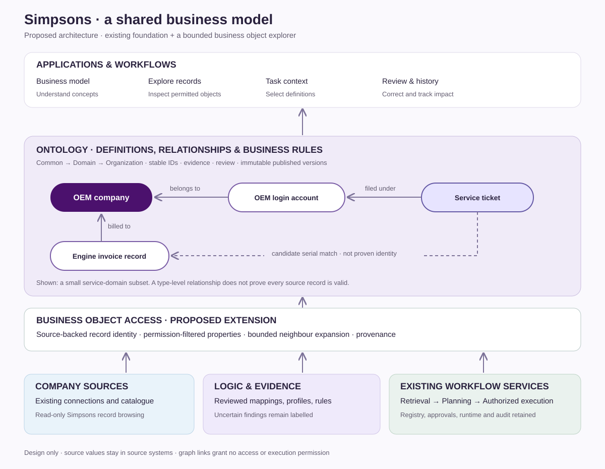
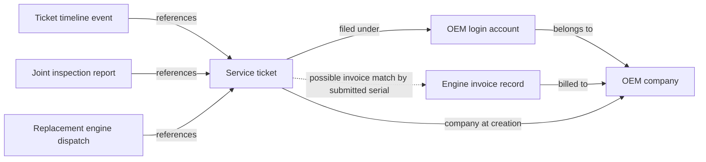

# Simpsons ontology workspace design

Status: proposed design, 31 October 2026. This document and its illustration are design artifacts, not a deployed feature. The owner requested a concrete design based on the supplied layered architecture example. No source data, approvals, running services or execution contracts are changed by this work.

**Implementation update:** the [source-backed record explorer](object-explorer.md) now implements the core concept-to-record-to-reference flow in the existing Ontology UI. This document retains the broader design, including proposed screen organization; it is not a claim that every platform capability in the reference illustration exists.

## What we are building

A shared business model connects company data to applications and controlled workflows. People can explore what the business concepts mean, inspect permitted company records through those definitions, understand their relationships, and use existing workflows with the relevant definitions attached.

The ontology defines types, relationships, mappings and rules. A business object is a particular source-backed record viewed through those definitions. Its current values come from authorized retrieval. Actions are separately authorized capabilities, not permissions created by a graph edge.



## Architecture and existing boundaries

| Layer | Simpsons example | Delivery approach |
| --- | --- | --- |
| Company systems | Connected Mongo collections; other connectors as configured | Reuse connections, catalogue, credentials and current access checks. |
| Logic and evidence | Declared references, reviewed definitions, bounded profiles, documented application behaviour | Reuse evidence and validation records. Keep observations separate from business policy. Models/optimizers in the reference image are optional future integrations, not prerequisites or currently delivered capabilities. |
| Ontology definitions | OEM company, OEM login account, engine invoice record, service ticket; attributes, relationships, constraints | Reuse versioned foundation records, review, publication and dependency selection. |
| Business object access | A particular company, account, ticket or invoice record and its permitted neighbours | Add a thin, bounded projection over existing retrieval. Instance retrieval is a new extension beyond the original concept-only scope. Do not build a second query engine or copy the enterprise database into ontology storage. |
| Applications | Business graph, object explorer, task view, review and history | Extend existing Data Intelligence → Ontology, retaining management controls. |
| Controlled actions | An existing configured workflow relevant to the selected object | Reuse registry, planner, workflow validation, approvals and runtime. List only actually configured capabilities; graph presence grants no execution authority. |

The reference drawing groups many capabilities on one platform. Our architecture keeps their responsibilities explicit: the ontology supplies meaning; retrieval supplies authorized values; the existing workflow services plan and execute.

## Screens and navigation

Keep the existing Ontology entry. Inside it, provide **Business model**, **Explore records**, **Task context**, and **Review & history**. These are proposed views; the deployed view currently offers a concept graph and Review & manage.

### 1. Business model

Default to the Simpsons service overview, with clearly labelled arrows:



This is a type-level diagram, not proof that every individual record has a valid target. Relationships open an inspector explaining direction, reference fields, multiplicity where verified, evidence, limitations and ontology version. Ordinary cycles are permitted; only relationship-specific prohibited cycles are rejected.

The concept inspector has Meaning, Fields, Relationships, Rules and Sources. A **Browse records** link opens the object explorer for supported, approved source mappings. Concepts without a resolvable source identity explain why browsing is unavailable. Physical engine remains such a concept until identity resolution is supported by evidence.

### 2. Explore records

Desktop layout:

```text
Ontology / Explore records                    [Source scope] [Version]
[Concept: Service ticket ▾] [Search permitted fields…] [Search]
┌─────────────────────┬─────────────────────────┬───────────────────────┐
│ Matching records    │ Selected record and     │ Record details        │
│                     │ labelled neighbours     │ Meaning / Values      │
│ Human label +       │                         │ Relationships         │
│ source identifier   │ Expand one relationship │ Source / fetched time │
│                     │ at a time               │ Available workflows   │
│ Load more           │ [Zoom] [Fit]            │                       │
└─────────────────────┴─────────────────────────┴───────────────────────┘
```

No sample ticket numbers, company names, totals or property values are fabricated for the design. Production labels and counts must come from permitted retrieval; unavailable counts are omitted or explained.

Select a ticket to see its permitted properties and source-backed neighbours. A stored account/company reference may return a resolved target, a missing target, an unavailable target or an unresolved reference. A serial match returns candidate invoice records, including multiple matches, rather than choosing the first.

Source identity is namespaced by workspace, connection, collection and immutable source record key. Keep the actual native key/type; display names and engine serials are not object IDs. Avoid combining equal keys from separate connections. Each result includes concept ID, ontology version, source reference, fetched-at time and any available source revision; freshness cannot imply a source revision exists.

Relationship results distinguish:

- **Resolved source reference:** a declared/reviewed reference was followed and a permitted target was found. This describes stored linkage, not proof of real-world ownership.
- **Candidate match:** evidence suggests an association; show the matching basis and ambiguity. It is excluded from automatic authoritative traversal.
- **Unresolved:** identity or mapping lacks sufficient evidence. Explain what is missing.
- **Unavailable:** retrieval failed or access is unavailable. Do not expose restricted targets, existence, labels or counts to unauthorized users.

Values distinguish **not recorded**, **field not returned**, **restricted**, and **could not load** where current authorization permits revealing that distinction. The interface never substitutes invented values or confidence numbers. Credentials, password fields and sensitive account details are excluded by server-side projection; collection access alone is insufficient to expose all fields.

Mobile uses a record list followed by the selected-object view, with Details and Relationships controls. Graph pan/zoom remains optional navigation; every visible relationship also has a keyboard-accessible list entry. Returning to the list preserves scope and search.

### 3. Task context

Enter a question or select an existing workflow. Show the chosen concepts and their required ontology dependencies, the approved version, relevant rules, and unresolved requirements. Reuse `OntologyFoundation.select` and the existing planning integration. This view selects definitions only: it is not a new context engine and does not automatically fetch every related record.

For “service history for this serial”, the preview must explain that serial-only physical identity is ambiguous and company scope is required. If the user elects to retrieve records, use a separate existing retrieval operation with explicit scope and ambiguity handling. The resulting data must remain distinguishable from the ontology definition manifest.

### 4. Review & history

Retain existing evidence, corrections, publication, version/export and downstream impact controls. Show the seven unresolved bindings as pending verification, not an empty enterprise model. Owner approval of descriptive application behaviour does not establish production calibration or validate undocumented business policy.

For a correction, show which definitions, selections, workflows and runs are affected. Reuse existing invalidation and replay eligibility/submission integration. Historical evidence remains available subject to current permissions. Do not add a recovery executor.

## One concrete interaction

1. Open Service ticket in Business model and read its reviewed meaning.
2. Choose Browse records and an authorized source scope. The server permits only supported fields and bounded operations.
3. Search using an allowed ticket identifier; open a returned record.
4. Expand Filed under to resolve its OEM account, then Belongs to to resolve its company. Show unresolved/dangling references explicitly.
5. Expand Possible invoice matches. Display permitted candidates and explain that bill-to company is not proven current ownership. Never merge candidates into one physical engine automatically.
6. Inspect a directly referenced report or dispatch where that mapping and target access are supported. Keep replacement serial distinct from complaint serial.
7. Open an existing available workflow. Pass the selected ontology definitions to existing planning; any object-derived input is separately validated under the existing workflow input contract. Review, authorization and submission remain in the existing flow. If no suitable workflow is configured, say so.

## Implementation design

Existing integration points inspected for this design:

- `frontend/src/features/data-sources/OntologyFoundation.tsx`: business model entry and graph.
- `OntologyRecordDetails.tsx` and `OntologyWorkbench.tsx`: readable definitions and management.
- `workflow_api/ontology_foundation.py`: published versions, source-aware access, `select`, `bind`, invalidation and replay integration.
- `workflow_api/database_workflows.py`: current source selection/retrieval and ontology-aware planning integration.
- `workflow_api/data_sources.py`: current connected-source scope and catalogue.

Add an object projection module and UI client only after checking the existing retrieval service's supported filters, key types, field authorization and reference traversal. Reuse supported operations; explicitly report unsupported operations. Do not issue arbitrary queries from browser-supplied collection names or bypass technical join authorization.

Proposed additive operations are **list objects**, **get object**, and **expand relationship**. Exact routes and request/response schemas remain to be specified through OpenSpec and the existing contract review process. Existing `/ontology/v1` responses and workflow/agent/tool contracts stay compatible. Do not overload the current `lookup` endpoint with record-instance semantics.

All three operations resolve the approved concept mapping on the server, require current source and field access, enforce pagination and resource limits, and return a permission-filtered projection with provenance. Initial proposed limits: 25 records per page, maximum 100; one relationship expansion per request with at most 25 targets and explicit continuation. Reuse stricter existing limits. Timeout, unsupported-filter, incomplete-result and ambiguous-identity states are explicit; no silent truncation. An empty permitted result does not assert absence across the enterprise.

Do not persist bulk object values in ontology records. If existing retrieval caches are used, retain their freshness policy, include source/ontology revisions and authorization scope in keys, and recheck access on use. Revoked access must invalidate usable cached results. Never send account credentials to the client, even inside collapsed diagnostics or export.

## Delivery sequence and acceptance

| Increment | Deliverable | Evidence required |
| --- | --- | --- |
| A. Object browsing | Approved company/account/ticket/invoice mappings, source-backed identity and readable record inspector | Isolated fixtures prove native-key handling, duplicate serials, field redaction, tenant isolation, pagination, empty/missing/denied states and no source writes. |
| B. Object relationships | One-hop reference resolution and explicit candidate invoice associations | Missing targets, cross-company restrictions, multiple candidates, current access checks and bounded traversal verified. Ordinary permitted cycles terminate within request bounds. |
| C. Task and workflow handoff | Existing definition selection plus existing workflow navigation/input validation | Manifest remains definition-only; no new execution authority, contract drift, implicit run submission or duplicated context/recovery engine. |
| D. Release | Desktop/mobile flows, operator notes and rollback | Backend/frontend/contract checks and actual rendered flows pass. Bounded read-only Simpsons acceptance confirms behavior without changing company records. Runtime/production capability claims require corresponding live evidence. |

These increments are proposed follow-on scope, separate from claims about completed foundation work. The seven unresolved fields and calibration remain visible; they do not block browsing otherwise supported concepts. No remaining business answers are required to finish this design. Implementation can begin with the confirmed company/account/ticket/invoice scope; ambiguous physical engine identity and undocumented policies remain explicitly unresolved.

## Current delivery versus this proposal

The [deployed graph](graph-ui.md) displays concepts and stored relationships, with readable inspectors and review controls. It does **not** yet provide the source-record explorer described here. The recorded publication contains 409 approved records and seven unresolved drafts; those counts are definitions and supporting records, not a count of company objects. See [deployment evidence](deployment.md) for the loaded release. This design does not deploy a change or assert end-to-end business acceptance.
