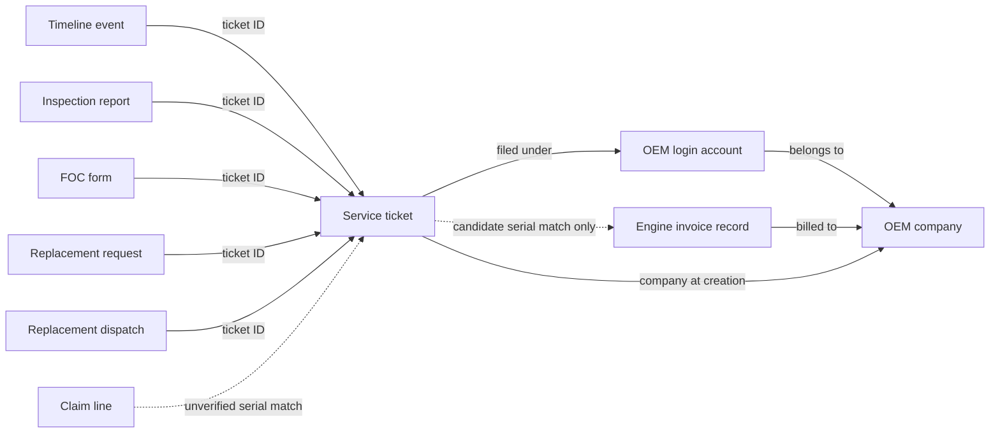

# Simpsons ontology draft

**Current live UI:** [Source-backed record explorer](../object-explorer.md). Click a concept → Browse records → select a record for permitted values and linked records. The [architecture design](../architecture-design.md) and [illustration](../architecture-design.svg) explain its boundaries; this generated draft remains historical evidence.

**Deployment update:** [409 records are now published in the live Ontology UI](../deployment.md); seven bindings remain drafts. The generated draft below is retained as historical evidence.

A later [technical verification and revised draft](../technical-verification.md) confirms four previously unobserved fields. This original draft is retained as historical evidence.

**Status: unpublished, documented application behaviour; business policy is not approved.**

Built from saved metadata and the supplied review answers. No company records were queried or changed. No workflow was planned or run.

Records: 416. Layers: {'common': 9, 'domain': 17, 'organization': 390}. Collection coverage: 51.

## Business concepts

| Concept | Collection | Meaning |
| --- | --- | --- |
| OEM company | oemnames | Equipment manufacturer in the company-name master. Company name is unique in the saved index; this is not a login account. |
| OEM login account | oems | Email login under an OEM company. Personal, shared plant and branch meanings are not distinguished by the application. |
| Simpson staff account | users | Staff login with roles from limits. A matching email in an OEM login does not establish identity equivalence. |
| Staff role flags | limits | Boolean roles for a staff account, not monetary or workload limits and not final ontology access policy. |
| Physical engine | Logical concept; no verified source identity | Physical engine as a business concept. Neither a serial-only lookup nor one invoice row guarantees globally resolved physical identity. |
| Engine invoice record | enginedetails | Invoice-master entry keyed by billed-to OEM company and engine serial. Billed-to company is not established current ownership; serial-first-match lookup is ambiguous. |
| Service ticket | tickets | One complaint form about one submitted engine serial, under an OEM account with company copied at creation; actual creator is separate. |
| Ticket timeline event | tickettimelines | Historical application log linked by ticket ID. Ticket fields, not replayed timeline events, represent current application state. |
| Ticket comment | comments | Comment linked to a ticket; actor kind may require its stored discriminator. |
| Joint inspection report | jointinspectionreports | One report per ticket according to code review, DRAFTED or PUBLISHED. Edits overwrite; this is not revision history. |
| FOC form | focs | Form against a ticket with dealer, failure, part quantity and warranty claim information. Acronym is undefined; no documented direct JIR or replacement-approval link. |
| Engine replacement request | enginereplacements | Ticket-linked replacement request or details. Simpson/OEM replacement modes are documented behaviour, not validated policy. |
| Replacement engine dispatch | floatengines | Ticket-linked dispatch record holding the replacement serial, while the ticket holds the complaint serial. Not the physical engine master. |
| Advance engine dispatch | advaced-engine-replacements | Advance engine sent under an OEM account. No ticket reference is documented. |
| Advance engine number lookup | advancedenginenumbers | Lookup reference, not independent proof of a physical engine or ticket relationship. |
| Failed-engine inward record | workorders | Inward receipt/transport/condition record for a failed engine. Ticket association uses free-text references; no guaranteed ticket ID link. |
| Part replacement line | partreplacements | Ticket-linked part line with free-text part/mode/scope/extra. Quantity is not stored here according to review. |
| Part description reference | parts | Description-only reference. No verified mapping to Simpson part numbers in claims or FOC. |
| OEM-entered claim line | claims | Entered/uploaded claim line under an OEM account. Not reconciled with SAP claim lines and not a guaranteed ticket reference. |
| SAP-imported claim line | claimsftps | Claim data imported from SAP files. OEM is text; dashboards use this collection. No validated manual-claim deduplication or ticket link. |
| SAP float-engine stock item | floatengineftps | Individual stock engine from SAP with serial, condition, stock and amount. Serial alone does not prove identity across companies. |
| Monthly float-engine inventory | floatinventories | Count/cost summary described as calculated from float-engine stock; currency and aggregation details remain unconfirmed. |
| Engine model product record | products | Model with multiple list-readiness entries. OEM and list numbers are text, without a guaranteed join to company/configuration masters. |
| Engine model reference | emms | Active reference using the record ID as a model name; distinct from a physical engine or invoice row. |
| Simpson controlled code | simpsoncodes | Active code list with COMPLAINT, DEFECT and ACTION types. Older code-list connections are not opened by the application. |
| Service bulletin | servicebulletins | Service guidance with company/model/list/plant cut-in information. Distinction from service information needs business review; text ordering is a defect. |
| Service information | serviceinformations | Same documented structure as bulletin with a different number field. No business distinction is inferred solely from schema. |
| Internal cut-in record | internalcutins | Plant/list/defect/model cut-in record. Physical serial ordering and applicability policy are not confirmed. |
| Failed engine analysis | failedengineanalyses | Independent quality process per serial with named quality approval; not directly linked to tickets. |
| Failed part analysis | failedpartanalyses | Independent quality process per part number. Active schema is code-reported; saved sample has no fields. |
| ICA/CAPA quality record | icacapas | Independent defect-based quality record. Acronym expansion is unconfirmed; saved sample has no fields. |
| Infant-care engine visit | infantcares | Early-life engine inspection visit with entered customer/representative details, not a ticket-linked record or proof of current owner. |
| Export engine complaint tracking | exportenginetrackings | Independent export complaint tracking with text serial/codes/company references; explicit cross-connection lookups are reported by the review. |
| Workshop manual | workshopmanuals | Model/OEM/list/version document with archive and approval fields. Latest release is not automatically approved or effective. |
| Workshop manual revision | workshopmanualrevisions | Code-reported revision with manual reference, version, release date and approval. No fields were observed in the saved sample. |
| FAQ entry | faqs | Staff-editable question/answer without an approval step; not automatically verified guidance. |
| Knowledge-sharing document | knowledgesharings | Uploaded topic/document reference. Business accuracy and continued validity require review. |
| Scheduled training course | courseschedules | Scheduled course with model, dates and status. Requested-by account reference is code-reported but absent from current sampled fields. |
| OEM training booking | trainingschedules | Booking against a course, with freely entered participants and admin acceptance/rejection. Participants are not account references. |
| Training material | training-modules | Uploaded material; no guaranteed course/session linkage is supplied. |
| Standalone calendar event | events | Calendar entry, separate from a scheduled course or training booking unless a reference is verified. |
| Monthly training measures | trainingtouchpoints | Manually entered targets and actuals. Touchpoint/man-hour definitions and formulas remain unconfirmed; domain placement is provisional. |
| Staff performance period record | performers | Code-reported staff record by month/year; no fields were observed in the saved sample. |
| Engineer attendance record | engineermovements | Staff/year attendance structure observed in metadata; detailed business interpretation is not supplied. |
| Legacy MIS fields | mis | salesCount/ticketsCount are documented as unused zero fields, not live business measures. Hardcoded chart denominators are not authoritative sales data. |
| Unused sales-data collection | saledatas | No application reads/writes reported and no sampled fields. Does not establish an authoritative sales source. |

## Main relationships

These arrows describe the draft meaning, not approved joins or access grants.

## Three question previews

These demonstrate concept/dependency selection only. They are not record answers, runtime manifests or published ontology versions.

### Full service history of engine X?

Selected 181 records. Business concepts: Ticket comment, Replacement engine dispatch, Physical engine, Engine invoice record, FOC form, Joint inspection report, OEM-entered claim line, OEM login account, OEM company, Part replacement line, Engine replacement request, SAP-imported claim line, Service ticket, Ticket timeline event.

Required checks:

- Require an explicit authorized company/source scope. Do not reproduce cross-company past-history exposure.
- Return candidate invoice identities rather than select the first serial match. Physical identity is unresolved.
- Claims are unverified serial associations and must not be silently merged into verified service events.
- Company billed at invoice is not current owner. Replacement serial differs from original complaint serial.

Unobserved source fields: tickets.engineReplacementStatus, tickets.cutInNumber, claimsftps.status.

### Engine replacements approved for company Y this financial year, and dispatch status?

Selected 88 records. Business concepts: Replacement engine dispatch, OEM login account, OEM company, Engine replacement request, Service ticket.

Required checks:

- engineReplacementStatus was not observed in the saved metadata sample; exact field binding must be verified.
- Do not replace historical approval with current workflow stage as an assumed equivalent.
- Use creation-based fiscal year for the documented application interpretation; approval-date policy is not confirmed.
- No current counts or dispatch outcomes are computed.

Unobserved source fields: tickets.engineReplacementStatus, tickets.cutInNumber.

### Which open tickets on model Z fall before a service-bulletin cut-in?

Selected 91 records. Business concepts: Service bulletin, Simpson controlled code, Internal cut-in record, Engine model reference, OEM company, Service ticket.

Required checks:

- Serial ordering is unconfirmed; plain text comparison is a documented defect. Do not compute a before/after answer.
- Do not apply only the first plant cut-in. Company/model/list/plant mappings require validation.
- Preserve field spellings and do not assume engineModal/model/engineModel or listNo/listNumber are interchangeable.
- This preview identifies required evidence; no company records are retrieved.

Unobserved source fields: tickets.engineReplacementStatus, tickets.cutInNumber.

## Unresolved bindings

A missing sampled field is not proof that the source schema lacks it. Code-reported fields remain explicit unresolved bindings; no source IDs or types are invented.

| Collection | Field | Status |
| --- | --- | --- |
| tickets | engineReplacementStatus | not_observed_in_saved_sample |
| tickets | cutInNumber | not_observed_in_saved_sample |
| advaced-engine-replacements | oem | not_observed_in_saved_sample |
| claimsftps | status | not_observed_in_saved_sample |
| failedpartanalyses | partNumber | not_observed_in_saved_sample |
| failedpartanalyses | approvedBy | not_observed_in_saved_sample |
| icacapas | defect | not_observed_in_saved_sample |
| workshopmanualrevisions | manual | not_observed_in_saved_sample |
| workshopmanualrevisions | version | not_observed_in_saved_sample |
| workshopmanualrevisions | approvedBy | not_observed_in_saved_sample |
| courseschedules | requestedBy | not_observed_in_saved_sample |

## Artifacts

- `ontology.json`: native records and per-record review/source provenance.
- `question-previews.json`: the three bounded ontology-only previews.
- `validation.json`: validation, source coverage, unresolved bindings and isolation evidence.

The isolated database path is recorded in validation.json. It has no copied connector credentials. Approved ontology APIs still reject use/publication of these draft records. Business review, actual reference integrity, calibration and approved publication remain separate gates.
