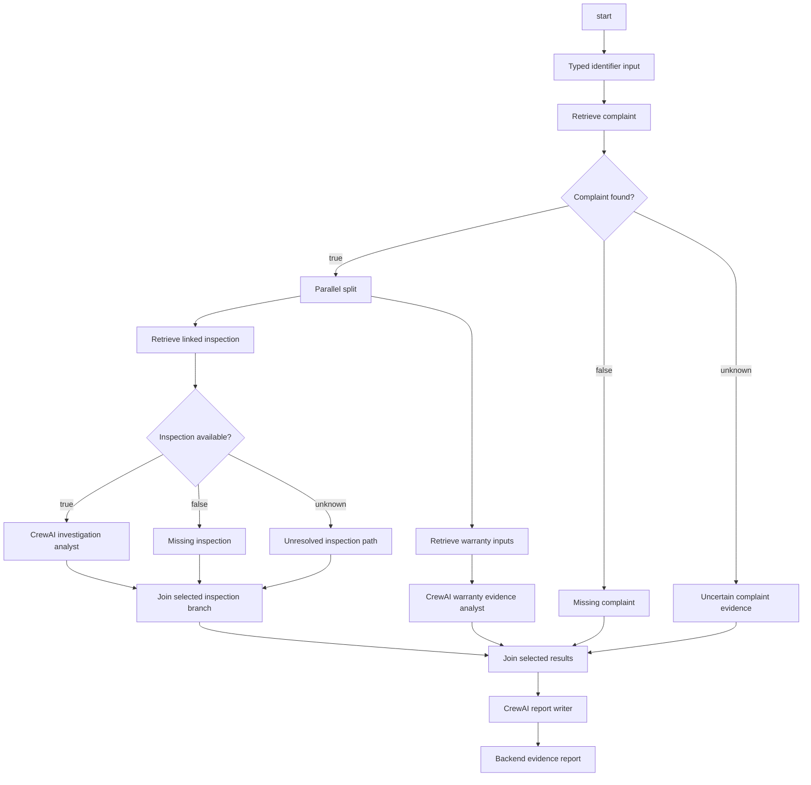

# Phase 3 — durable backend investigations

Phase 3 composes supported Simpson investigations into validated DAGs and executes them through backend-controlled retrieval, deterministic conditions and bounded CrewAI tasks.

`objective → Phase 2 knowledge and gaps → model graph proposal → validation → durable parallel execution → source-backed report`

This is a backend domain extension. It does not publish a general production workflow, add the visual canvas, send external messages, modify company records or approve warranty/replacement decisions.

## Verified acceptance

The actual request was:

> Investigate complaint A-2022-12-013, compare the reported complaint with its linked inspection, check whether enough evidence exists for warranty assessment, and prepare a report explaining discrepancies and missing information.

The configured model generated a valid 18-node graph on its first attempt. The executor retrieved the real complaint and linked inspection through Phase 2, performed independent inspection/warranty retrieval on a bounded parallel frontier, selected the matching branches and ran three real CrewAI analytical tasks. Source IDs matched an independently queried expected ticket/report set. It completed with evidence gaps, not an official warranty decision.

Private final evidence is in `/tmp/simpson-phase3-live-model-fixed-20261103/`. The original live application knowledge and company records were unchanged. Actual model evaluation was explicitly authorized for bounded mapped evidence sent to the configured `api.openai.com` endpoint; credentials and arbitrary attachments were excluded and Responses storage was disabled.

## Terminal: inspect the completed real run now

Run from the repository:

```bash
cd /home/raf/agentic-ai-builder

investigate() {
  .venv-integrations/bin/python scripts/simpson_investigation.py \
    --database /tmp/simpson-phase3-live-model-fixed-20261103/isolated.sqlite3 \
    --credentials-database .local/workflows.sqlite3 \
    "$@"
}

WORKFLOW_ID=$(.venv-integrations/bin/python -c \
  'import json; print(json.load(open("/tmp/simpson-phase3-live-model-fixed-20261103/phase3-report.json"))["workflow_id"])')

RUN_ID=$(.venv-integrations/bin/python -c \
  'import json; print(json.load(open("/tmp/simpson-phase3-live-model-fixed-20261103/phase3-report.json"))["run_id"])')

investigate capabilities
investigate graph --workflow-id "$WORKFLOW_ID"
investigate validate --workflow-id "$WORKFLOW_ID"
investigate inspect --run-id "$RUN_ID"
investigate report --run-id "$RUN_ID"
```

Expected: valid graph, completed run, selected `found=true` and `has_inspection=true` branches, source-linked findings, configured readiness outcomes and missing facts. Inspecting/reporting performs no new model call or company-record query, but rechecks current ownership, permissions and source metadata. A changed metadata/binding stamp can correctly reject access to a stale executable plan; create a new plan instead of editing stored JSON.

## Terminal: plan and execute your own request

Using the function above:

```bash
investigate plan \
  --objective 'Investigate complaint A-2022-12-013, compare its linked inspection, check warranty readiness and prepare a report.' \
  --request-key "investigation-plan-$(date +%s)" \
  > /tmp/investigation-plan.json

WORKFLOW_ID=$(.venv-integrations/bin/python -c \
  'import json; print(json.load(open("/tmp/investigation-plan.json"))["workflow_id"])')

investigate validate --workflow-id "$WORKFLOW_ID"

investigate run --workflow-id "$WORKFLOW_ID" \
  --request-key "investigation-run-$(date +%s)" \
  > /tmp/investigation-run.json

RUN_ID=$(.venv-integrations/bin/python -c \
  'import json; print(json.load(open("/tmp/investigation-run.json"))["run_id"])')

investigate execute --run-id "$RUN_ID" > /tmp/investigation-result.json
investigate report --run-id "$RUN_ID" > /tmp/investigation-report.json
```

Default planning uses the configured model. Default analytical execution uses real CrewAI through the existing bounded model bridge. These operations make paid provider calls and send bounded mapped business evidence to the configured model endpoint. Each request still goes through graph, source, permission, evidence and budget validation. No agent receives database tools, shell access, code execution or delegation authority.

Read a compact result:

```bash
.venv-integrations/bin/python - <<'PY'
import json
r=json.load(open('/tmp/investigation-report.json'))
if 'error' in r:
    print(json.dumps(r,indent=2))
    raise SystemExit(1)
print('Status:',r.get('completion_status',r.get('status')))
print('Ontology:',r.get('version_id'))
print('Branches:',r.get('branch_decisions'))
print('Source observations:',len(r.get('source_records',[])))
print('Readiness outcomes:',len(r.get('configured_rule_outcomes',[])))
print('Missing information:',json.dumps(r.get('missing_information',[]),indent=2))
for a in r.get('agent_interpretations',[]):
    print('\nAgent summary:',a['summary'])
    for f in a['findings']:
        print(f['kind'],f['statement'],f['references'])
PY
```

If a command returns an error, inspect that JSON before extracting an ID. Do not run execute with a blank run ID. Unlike the Phase 2 preview, a Phase 3 plan is a validated workflow definition; a separate `run` creates execution state.

## Fresh isolated acceptance store

To reproduce the full independently checked acceptance, choose a new directory:

```bash
cd /home/raf/agentic-ai-builder
INVESTIGATION_DIR=$(mktemp -u /tmp/simpson-phase3-check-XXXXXXXX)

.venv-integrations/bin/python scripts/check_simpson_investigation.py \
  --database .local/workflows.sqlite3 \
  --directory "$INVESTIGATION_DIR" --models
```

Expected: `passed: true`, model planning, `analysis_mode: crewai`, valid graph, completed run, exact source-ID comparison, explicit gaps, unchanged original knowledge, zero company/live-application writes and zero copied credentials. `--models` intentionally performs the bounded external-model evaluation described above.

Omit `--models` for a live-source read-only diagnostic with **zero model calls**. Its graph is labelled `planning.mode: offline` and its analyses `mode: offline`; it does not claim to have performed CrewAI reasoning. The same executor, predicates, joins, retrieval and persistence services run in both modes.

For an individual offline plan, add:

```bash
--planning-mode offline --analysis-mode offline
```

Offline mode is useful for testing graph control flow and source correctness independently of a model. It is not silently substituted when a model plan fails. Invalid model graphs get at most one repair attempt, then return explicit validation errors.

## Supported request families

Use concrete existing identifiers, such as the verified complaint `A-2022-12-013` or engine serial `S325M79495`:

```text
Find service issues for motor S325M79495 and prepare a report.
Compare complaint A-2022-12-013 with its linked inspection.
Check warranty evidence readiness for complaint A-2022-12-013.
Review replacement evidence for complaint A-2022-12-013.
Investigate complaint history for engine S325M79495.
```

These examples select reusable capabilities and their required dependencies. They do not guarantee a record exists in every requested collection. Empty linked results, unsupported anchored paths and insufficient business evidence remain explicit. History uses independently source-qualified invoice/QA observations; equal serials do not merge engines.

Population rates/rankings, recurrence/cut-in conclusions, arbitrary source filters, operational actions and external messaging are not supported Phase 3 workflows. Phase 2's narrower retrieval grammar remains authoritative; the investigation planner cannot create new query fields or relationships.

## Waiting, input and resume

A missing identifier creates a real waiting state before company reads:

```bash
investigate plan \
  --objective 'Investigate this complaint and compare its linked inspection.' \
  --planning-mode offline --analysis-mode offline \
  --request-key "missing-anchor-plan-$(date +%s)" \
  > /tmp/waiting-plan.json

WAIT_WORKFLOW=$(.venv-integrations/bin/python -c \
  'import json; print(json.load(open("/tmp/waiting-plan.json"))["workflow_id"])')

investigate run --workflow-id "$WAIT_WORKFLOW" \
  --request-key "missing-anchor-run-$(date +%s)" > /tmp/waiting-run.json

WAIT_RUN=$(.venv-integrations/bin/python -c \
  'import json; print(json.load(open("/tmp/waiting-run.json"))["run_id"])')

investigate execute --run-id "$WAIT_RUN"

investigate input --run-id "$WAIT_RUN" \
  --json '{"request_key":"supply-complaint-001","identifiers":{"complaint_id":"A-2022-12-013"}}'

investigate resume --run-id "$WAIT_RUN"
investigate report --run-id "$WAIT_RUN"
```

The first execute returns `waiting_for_input`. Supplying the typed identifier makes the run eligible to resume. Completed start/checkpoint nodes remain completed. The supplied identifier is a lookup input; any user assertion remains labelled unverified, not company evidence.

A plan created with `--wait-for-information` can pause at the final report when gaps remain. It accepts an explicit acknowledgment and optional notes:

```bash
investigate input --run-id "$RUN_ID" \
  --json '{"request_key":"acknowledge-gaps-001","acknowledge_gaps":true,"notes":"Policy applicability is not available."}'
investigate resume --run-id "$RUN_ID"
```

Acknowledgment permits finalizing a report **with the same evidence gaps**. It does not establish policy applicability, verified identity or any missing source fact. Retrieval inputs cannot be changed after source execution. Additional verified business evidence requires a separate future ingestion/evidence-authority capability or a new investigation against updated versioned knowledge.

For errors, inspect `node_errors`, `attempts`, `events`, `node_times`, `invocations` and `pending_inputs`. Eligible source failures can resume once within the node's declared two-attempt limit. Nonretryable output/permission/graph failures cannot be bypassed through resume. An interrupted model call has no automatic retry; its reserved call budget remains consumed. Create a corrected plan/run when the node budget is exhausted.

Cancel a nonterminal run:

```bash
investigate cancel --run-id "$RUN_ID"
```

Cancellation prevents new node dispatch and fences late results. Already in-flight read/provider requests cannot be forcibly rolled back; their output is discarded after cancellation. There are no company writes to undo.

## Graph, capabilities and execution

The versioned backend graph schema is `workflow_api/schemas/simpson-investigation-v1.json`. Nodes have stable IDs, a supported type, capability/predicate reference, typed upstream input bindings, output type, constraints, error policy and join mode. Edges have source/target and nullable `true`, `false` or `unknown` outcomes. Graphs are DAGs; cycles and arbitrary loops are rejected.

The capability catalogue includes:

- Complaint retrieval.
- Linked inspection retrieval.
- Warranty input retrieval.
- Replacement evidence review/retrieval.
- Complaint/invoice/QA history retrieval.
- CrewAI complaint/inspection comparison.
- CrewAI warranty evidence-readiness review.
- CrewAI report writing.
- Deterministic missing-information identification.

Each capability records its stable ID, schema, input/output types, required concepts/evidence, implementation, permissions, limits and retry policy. Its saved fingerprint is checked on every execution/resumption. Readiness computations come from Phase 2's pinned configured rules; the warranty analyst explains them, not replaces them.

The accepted investigation graph had this structure:



A three-valued predicate selects branches without an LLM. Published report status never means activity completion. Joins wait for all incoming paths to resolve, then combine selected paths; skipped branches propagate skips. Independent nodes on the ready frontier run in up to three threads. This is bounded frontier parallelism, not a fully asynchronous distributed scheduler; a frontier completes before the next one is scheduled.

Plan definitions, revisions, hashes, knowledge version, catalogue version and source stamps persist in `business_investigation_plans`. Runs persist in `business_investigation_runs`: states, input/output references, evidence, branches, invocation IDs, attempts, errors, usage, times, pending inputs and audit events. SQLite write transactions/PostgreSQL row locks protect claims, and an expiring run lease with the existing heartbeat fences concurrent executors. Work happens outside database transactions. Completed nodes are not re-executed after interruption.

This domain service reuses the existing pure runtime DAG frontier, `WorkflowStore`, `LeaseHeartbeat`, `CrewAdapter`, `BoundedLLM`/`OpenAIModelFactory`, BusinessSources authorization and Phase 2 retrieval. It does not bypass generic approved-workflow release/registry gates: it has its own explicit read-only capability allowlist and cannot execute general connectors. Existing production workflow/agent/tool contracts are unchanged.

## Evidence integrity, limits and security

The final backend report keeps these sections separate:

- Source records, native references and observation timestamps.
- Retrieved mapped facts.
- Configured readiness-rule outcomes and provenance.
- Agent interpretations with validated record/mapping references.
- Branch decisions and node errors.
- Missing information, invalid values and candidate associations.
- Explicitly unverified user assertions.

The actual acceptance report completed with gaps. It retained the retrieved ticket/report, two configured readiness outcomes and the missing identity/policy/activity facts. Its exact private report is `final-report.json`; the graph and full execution history are `workflow-plan.json` and `workflow-run.json`. Agent narrative remains interpretation: valid citations do not prove semantic entailment. The backend does not claim automated verification of every model statement; unsupported identity/approval/diagnosis statements are marked unverified, and no narrative grants execution authority.

Limits: 32 nodes, three parallel tasks, 240 seconds of active run time, six reserved analytical model calls, 14,000 tokens and 45 seconds per agent, a configured per-agent cost ceiling of $0.25, 500 KB agent evidence and 2.5 MB persisted run state. Phase 2's stricter per-read and record limits still apply. Required context overflow is an explicit error; it is not silently trimmed to fit. Provider usage is recorded separately from conservative failed/interrupted-call reservations. Planning permits at most two model calls and has a separate bounded output/context/timeout budget.

Read-only capabilities require current `tools.read` and `workspace:read`; execution/input/resume/cancel additionally require `workflow.execute`. Source ownership and stamps are checked during dispatch and before returning run evidence. Client-edited graphs are not execution authority. Agents have no tools, code execution, memory or delegation. Source-record instructions are untrusted; the existing injection and credential guards can fail a node rather than allow those instructions to control tools.

The local CLI uses local operator access to the explicitly selected isolated database. It is not an HTTP authentication replacement. The normal API uses actual session permissions and origin protection. Borrowed source credentials remain in memory and are not copied into isolated storage.

## Backend API

All routes are under `/business-ontology/v1/investigations`:

| Method/path | Purpose |
| --- | --- |
| `GET /capabilities` | Inspect versioned catalogue |
| `POST /plan` | Objective, request key, optional version/inputs, planning/analysis mode |
| `GET /plans/{workflow_id}` | Inspect saved graph and knowledge context |
| `POST /plans/{workflow_id}/validate` | Validate saved plan; body `{}` |
| `POST /plans/{workflow_id}/runs` | Create scoped run with request key |
| `GET /runs/{run_id}` | Inspect states, evidence, branches and errors |
| `POST /runs/{run_id}/execute` | Execute saved run; body `{}` |
| `POST /runs/{run_id}/resume` | Resume eligible run; body `{}` |
| `POST /runs/{run_id}/input` | Supply typed requested inputs with request key |
| `POST /runs/{run_id}/cancel` | Cancel; body `{}` |

Plan example:

```json
{
  "objective": "Compare complaint A-2022-12-013 with its linked inspection and check warranty readiness.",
  "request_key": "investigation-plan-001",
  "planning_mode": "model",
  "analysis_mode": "crewai",
  "inputs": {"identifiers": {"complaint_id": "A-2022-12-013"}}
}
```

## Changed implementation files

- `workflow_api/investigation_graph.py`: catalogue, schemas, requirements, offline structural planner, validation and predicates.
- `workflow_api/schemas/simpson-investigation-v1.json`: exported graph schema.
- `workflow_api/investigation_planning.py`: actual bounded model graph planning and one repair.
- `workflow_api/investigation_agents.py`: real CrewAI roles, bounded evidence packets and output/reference validation.
- `workflow_api/business_investigations.py`: scoped plans, leased durable executor, branches/parallelism, reports, input/resume/cancel and audit.
- `runtime/graph.py`: shared pure frontier helper, reused by existing GraphRunner and investigation execution.
- `workflow_api/business_retrieval.py`: per-request execution locks so independent source reads can overlap; same-request single-flight remains.
- `workflow_api/business_ontology_routes.py`: backend routes.
- `scripts/simpson_investigation.py`: terminal interface to the same service.
- `scripts/check_simpson_investigation.py`: isolated live/model acceptance with independent expected source IDs.
- `tests/test_investigation_graph.py`, `tests/test_business_investigations.py`: graph, persistence, parallelism, CrewAI, security and API acceptance.
- `openspec/changes/simpson-workflows-phase3/`: design/specification/tasks/verification.

Capability changes require catalogue/schema updates and tests; existing saved plans intentionally become stale when their capability fingerprint changes. Business mapping/rule changes remain versioned Phase 1 imports. Existing request knowledge is not silently altered.

## Remaining boundaries before visual integration

Current investigation token policy is provider-managed after explicit user approval: planning/analysis send no application output-token cap and enforce no application token or cost ceiling. Actual usage is recorded; call/time, source scope and validation controls remain. Final-summary truncation preserves an explicitly qualified evidence report without paid replay. Generic runtime agents retain their existing budgets. See [provider-token rollout](../../openspec/changes/investigation-provider-token-policy/verification.md). Existing workflows can start a fresh run without regeneration for this change.

The later [backend evidence refinement](evidence-refinement.md) adds task requirements, supported lookups and normalized gaps. It was deployed with the [report-schema reliability fix](../../openspec/changes/investigation-report-schema/verification.md) after explicit user approval, importing live revision 8. Generate a fresh plan for its updated catalogue.

The implementation supports the listed Simpson request families, not arbitrary enterprise workflows. There is no canvas, general visual editing, distributed worker fleet, streaming scheduler, arbitrary loop, approved business-write capability or external notification. Human input currently supplies an initial lookup context or acknowledges report gaps; it cannot certify missing business evidence. Cross-source model/company identity context remains limited by saved mappings. Natural-language scope filters beyond the supported Phase 2 grammar require new validated capabilities, not an LLM guess.

The original backend-only acceptance did not deploy or import live knowledge. The subsequent authorized UI rollout is deployed; see [the workflow UI guide](investigation-workflow-ui.md) and [rollout verification](../../openspec/changes/investigation-workflow-ui/verification.md). See [backend verification](../../openspec/changes/simpson-workflows-phase3/verification.md) for the earlier provider evaluations and limitations.


The local [connected evidence coverage extension](evidence-coverage.md) adds validated scenario environments, typed business-record providers, pre-run coverage and runtime revalidation. Its local UI separates execution, mandatory decision evidence and optional limitations. This extension has not been deployed or imported into the live application.


The backend-only [shared preparation Phase 1](shared-preparation.md) now connects investigation preflight and general dynamic planning to one scoped preparation service, with pinned evidence and a read-only runtime adapter. Implemented locally; no frontend/deployment or next-phase agent factory changes.


The backend-only [dynamic capability composition Phase 2](dynamic-composition.md) adds registered capability/task planning, task-specific configurations, Registry matching and guarded existing master-child/CrewAI execution. Local implementation only; existing investigation/UI behavior remains. Memory/recovery Phase 3 has not started.


## Dynamic platform memory and recovery — 4 November 2026

Backend memory/recovery and immutable client packages build on the shared preparation/composition path. See [memory and recovery](agent-memory-recovery.md) for scoped checkpoints, validated experience, guarded resume, retail acceptance and exact local tests. This is separate from the earlier Simpson investigation phase numbering; no deployment or frontend change.
